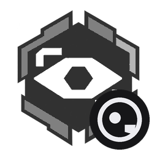

# 第一人称 (First Person) · ZML 改版

给《明日方舟：终末地》的第一人称视角模组。在原版基础上重做了眼位跟随与视角平滑，另补上视角接管保持等功能。

> 基于 [sakevel/Endfield-FirstPerson](https://github.com/sakevel/Endfield-FirstPerson) 0.1.6 修改，由 snowinging 维护。
> 上游未声明开源协议；来源与使用约定见 [NOTICE.md](NOTICE.md)。

## 这个改版改了什么

- **真实眼位跟随**：镜头直接取头骨的世界坐标与姿态，跑动、蹲伏、空翻时视线随身体一起走；位置通路完全不做滤波。
- **平滑与跟手分开**：滤波只加在头骨动画偏移这一段，鼠标输入不经过滤波，两者不互相拖累。
- **修掉空翻时的顿挫**：朝向改用四元数合成，去掉欧拉角分解与单帧硬吸附，头骨接近奇点时不再突跳。
- **视角接管保持**：输入封锁、鼠标光标、界面层、临时相机、角色演出、相机控制器六种情况，可以分别选择不把相机交还游戏。
- **原地转身**：视角偏离角色朝向超过阈值时自动平滑转身，可另开游戏原生迈步转身动作。
- **图标**：在原版图标上叠加了本改版的标识。

## 功能

- **自由视角**：40°~120° 垂直视野调节，独立灵敏度倍率。
- **身体可见**：低头能看到自身躯干与四肢，第一人称下自动隐藏头部模型。
- **头颈跟随**：镜头绑定真实头部位置，转视角时沿头颈关节弧线运动，跟随强度可调，可另开头部侧倾。
- **角色专属视野**：汤汤的眼罩遮挡、管理员的抑制器扫描波纹与光带、大潘的墨镜滤镜。
- **自动交还**：过场动画、剧情对话、全屏菜单打开时，相机自动交还游戏原生控制。

## 操作方式

| 操作 | 默认键位 / 入口 | 说明 |
|---|---|---|
| 切换视角 | `Ctrl+F5` | 切换第一人称与第三人称（可在游戏「设置 → 按键绑定」修改） |
| 参数调节 | `ESC` → 模组菜单 → 第一人称 | 实时调整视野（FOV）、灵敏度、眼高及跟随选项 |

## 配置项

共 33 项，全部在模组菜单面板里实时生效。其中「视角接管诊断」仅用于排查相机控制权问题，日常保持关闭。

## 安装

1. 先装 [ZML 加载器](https://github.com/sakevel/Endfield-ModLoader)。
2. 启动器里点「模组 → 获取模组」安装，或从 [Releases](https://github.com/snowinging/ZML-FirstPerson-Remix/releases) 下载 zip 解压到 `ZML/mods/first-person-remix/`。
3. 依赖 [按键绑定](https://github.com/sakevel/Endfield-Keybinds)，需要一并安装。

## 来源与署名

- 原作者：永动接线器 · [sakevel/Endfield-FirstPerson](https://github.com/sakevel/Endfield-FirstPerson)
- 改版维护：snowinging
- 详细的来源说明与使用约定见 [NOTICE.md](NOTICE.md)
